# 04.01 一号车设计思路

> 记录 1 号车的设计变化（改了什么、为什么改、影响什么），按日期从早到晚追加。来源：日报 + 大修记录；整机口径见 [1.1 外形展示](1.1-外形展示.md)。

## 1 号车

**2026-09-28 初始设计思路（立项）**

- 记录人：蔡昌恒
- 适用对象：1 号车
- 改动（改前 → 改后）：从零开始 → 定为"麦轮取块车"，人工 PS2 操作，抢高分道具
- 为什么改：1 号车在 h5/a4 高台启动，下坡就能到本方半场；黄块 4 分/颗，是全场价值最高的目标，值得用一台车专门去拿
- 影响与后续动作：据此确定尺寸 240×160×200、举升 260 mm、三种取块头；遗留问题——车宽 160 mm 过不了 150 mm 桥面

<!-- 追加位置 -->

**当天照片：**

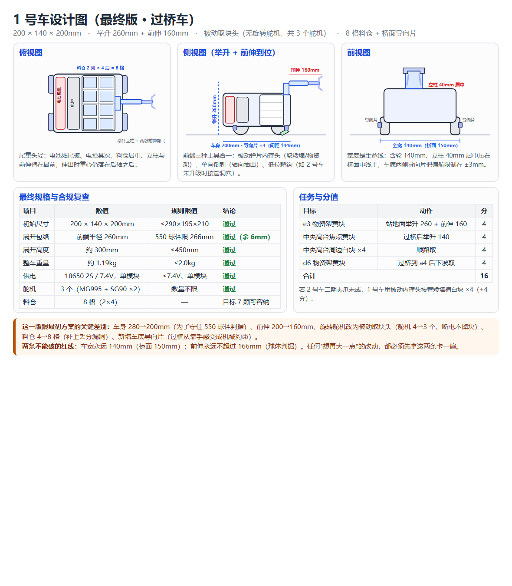

[打开图片：蔡昌恒-2-b36826c4](images/日报配图/2026-09-28/蔡昌恒-2-b36826c4.png)

### 2026-10-04 一号车 V2 定稿：部件详图、高度链复核与下探底架

- 记录人：蔡昌恒
- 适用对象：1 号车
- 改动（改前 → 改后）：改前：三档高度表 + 转塔 φ46 + 丝杆 160 + 背部 8 格竖排料仓 + 前开口低仓；改后（V2）：取块头轴线绝对高度体系 + 转塔 φ32 + 丝杆 170 + 2×5 十格托盘（格口朝上）+ 回缩臂 + 刮料唇，立柱底座改为轮间下探底架（离地 10 → 柱顶 200）。
- 为什么改：① 初始高度红线 ≤210，立柱基准不对会到 255；② φ46 在低位作业时盘底离工作面只剩 2 mm（φ32 后 9 mm）；③ 丝杆 160 对一级 130 只剩 10 mm 余量；④ 臂低于板面 100 时后收会撞 40 mm 高的料仓壁。
- 影响与后续动作：底盘板开 34×28 让位槽，打印底座板 60×40×5 与 L 形侧板 ×2；电控增加“臂低于板面 100 mm 禁止后收”的互锁；图纸汇总 V2 共 16 张（两车总图 + 分工 + 详图 1–10 + 高度体系 + 对位误差表 + 手柄映射）。

**当天照片：**

[打开图片：蔡昌恒-1-f1df20ad](images/日报配图/2026-10-04/蔡昌恒-1-f1df20ad.png)
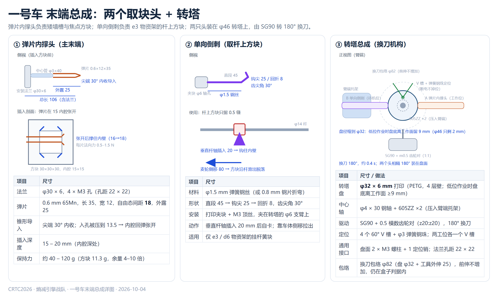

[打开图片：蔡昌恒-2-7d33fbbb](images/日报配图/2026-10-04/蔡昌恒-2-7d33fbbb.png)

[打开图片：蔡昌恒-3-34462ad7](images/日报配图/2026-10-04/蔡昌恒-3-34462ad7.png)
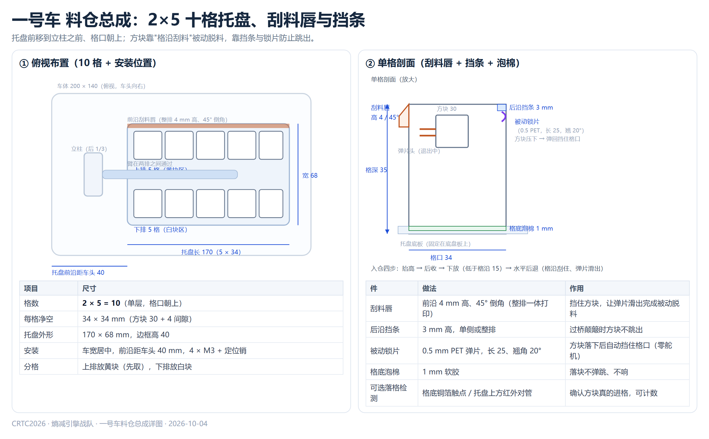

[打开图片：蔡昌恒-4-e6a2aa99](images/日报配图/2026-10-04/蔡昌恒-4-e6a2aa99.png)

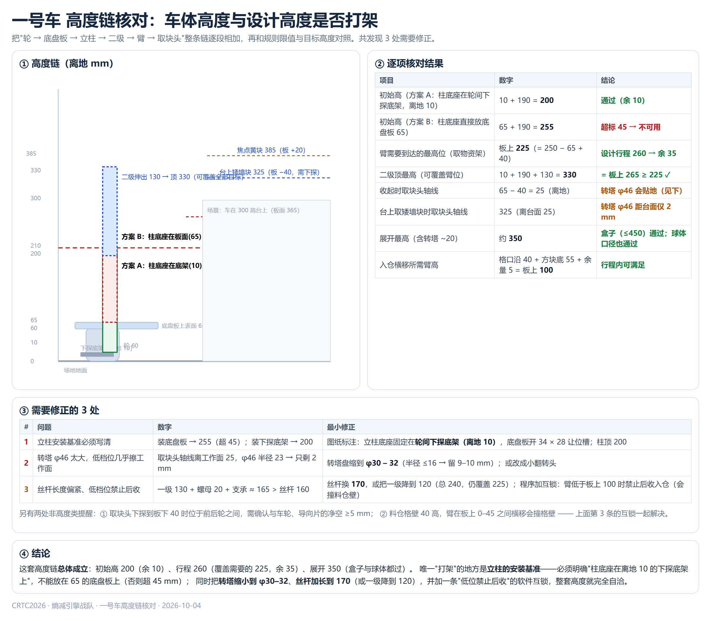

[打开图片：蔡昌恒-6-9f44d16f](images/日报配图/2026-10-04/蔡昌恒-6-9f44d16f.png)
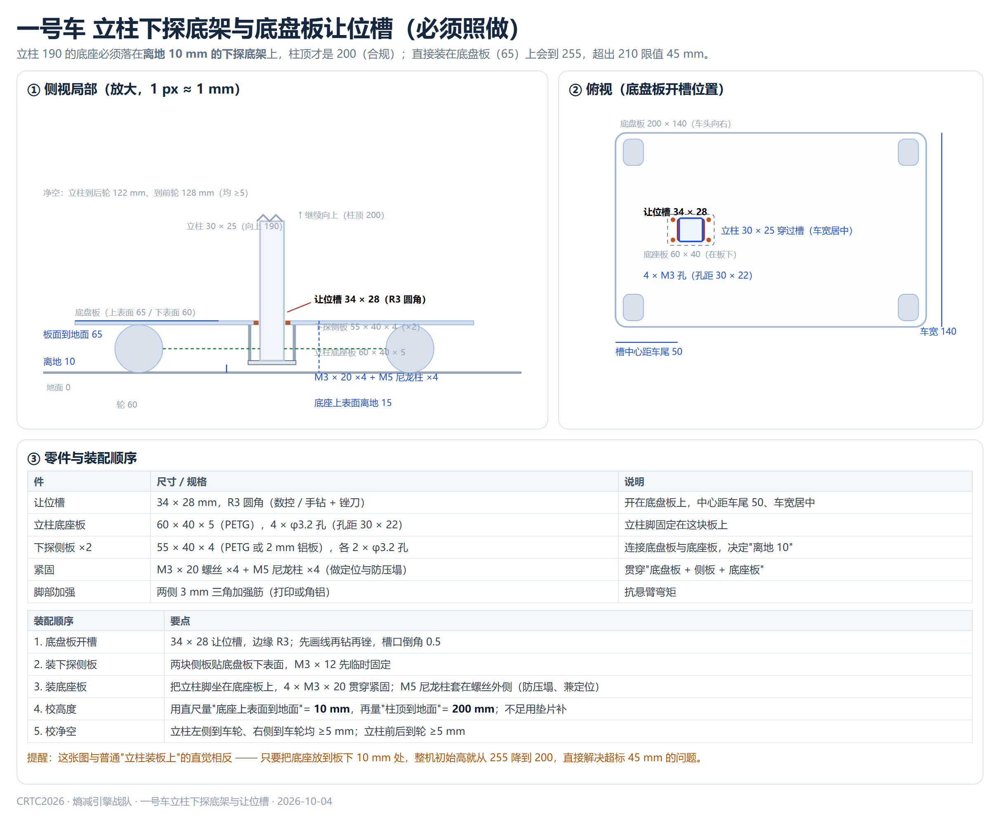

[打开图片：蔡昌恒-7-ab93c627](images/日报配图/2026-10-04/蔡昌恒-7-ab93c627.png)

**2026-10-04 举升六档行程与取块高度体系（修正版）**

- 记录人：蔡昌恒
- 适用对象：1 号车
- 改动（改前 → 改后）："相对车底的举升三档" → **按"取块头轴线离地绝对高度"定义的取块高度体系**（高度 = 方块内腔中心离地）：

| 目标（方块内腔中心）              | 离地高度        | 相对底盘板（65） | 车在哪     | 备注                                |
| ----------------------- | ----------- | --------- | ------- | --------------------------------- |
| 地面白块 a8 / h1 / c4 / f5  | 15 mm       | −50（下探）   | 地面      | 取块头最低位                            |
| 台阶面白块 e8 / d1 · d6 / e3 | 165 mm      | +100      | 地面      | 台阶层                               |
| 附属高台矮墙白块 e8' / d1'      | 185 mm      | +120      | 地面      | 矮墙槽（游隙 ±0.75）                     |
| 物资架黄块 e3 / d6           | 250 mm      | +185      | 地面      | 行程上限                              |
| 台面矮墙白块（中央高地十字基座）        | 325（台面 +25） | −40（下探）   | 300 高台上 | 过桥后取（V1.5：基座 300×300，槽位距中心 64.25） |
| 焦点黄块（70 平台上）            | 385（台面 +85） | +20       | 300 高台上 | 先手目标                              |

- 
两车分工与目标清单：**

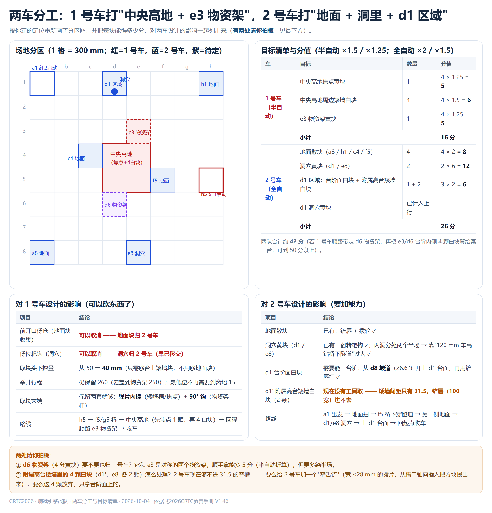

[打开图片：两车分工与目标清单](images/设计图/两车分工与目标清单.png)

**1 号车设计方案 V2：**

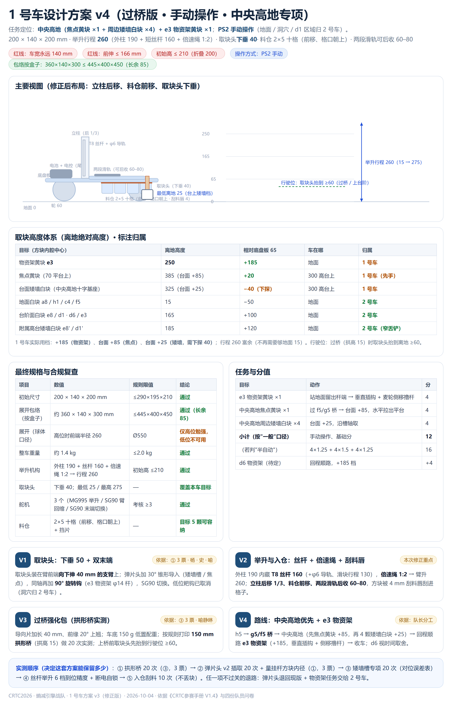

[打开图片：1号车设计方案V2](images/设计图/1号车设计方案V2.png)

**2 号车设计方案 V2：**

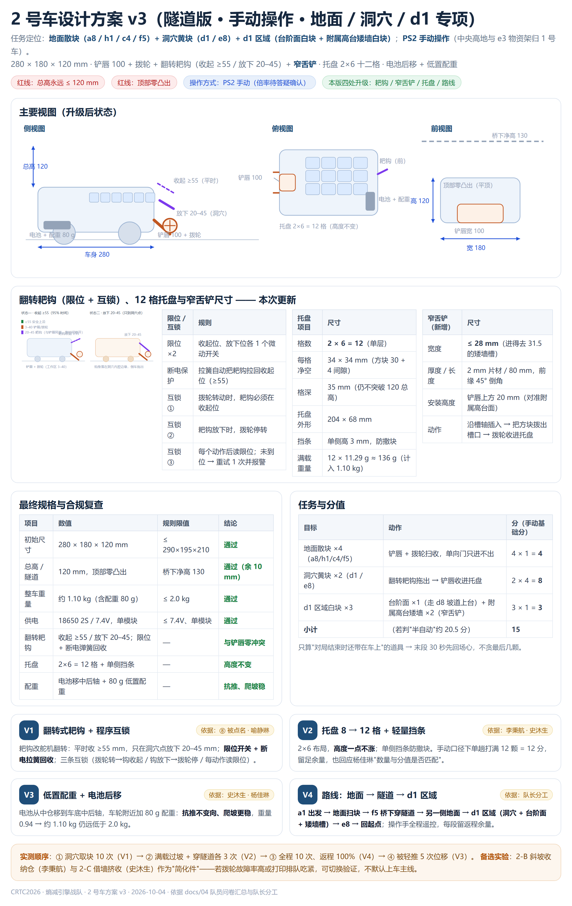

[打开图片：2号车设计方案V2](images/设计图/2号车设计方案V2.png)

**一号车部件详图 1–10：**

[打开图片：一号车详图1-取块头与转塔](images/设计图/一号车详图1-取块头与转塔.png)

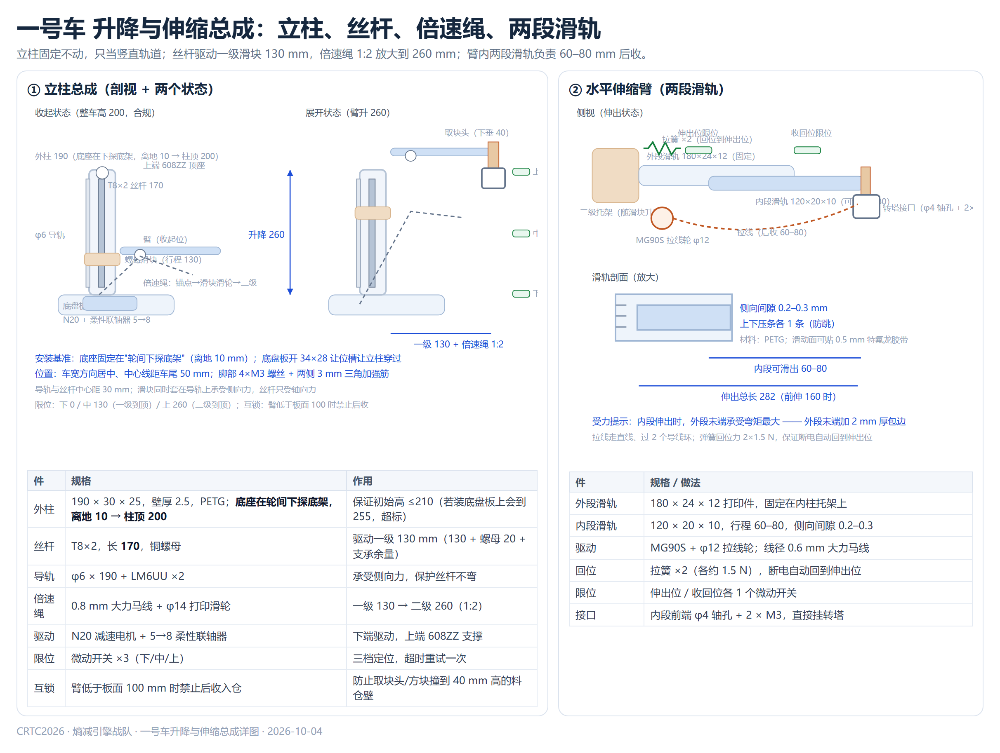

[打开图片：一号车详图2-升降与伸缩总成](images/设计图/一号车详图2-升降与伸缩总成.png)

[打开图片：一号车详图3-料仓总成](images/设计图/一号车详图3-料仓总成.png)

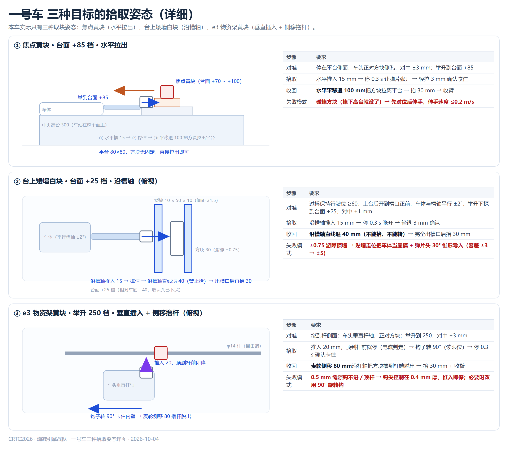

[打开图片：一号车详图5-三种拾取姿态](images/设计图/一号车详图5-三种拾取姿态.png)

[打开图片：一号车详图9-下探底架与让位槽](images/设计图/一号车详图9-下探底架与让位槽.png)

**取块高度体系与对位误差表：**

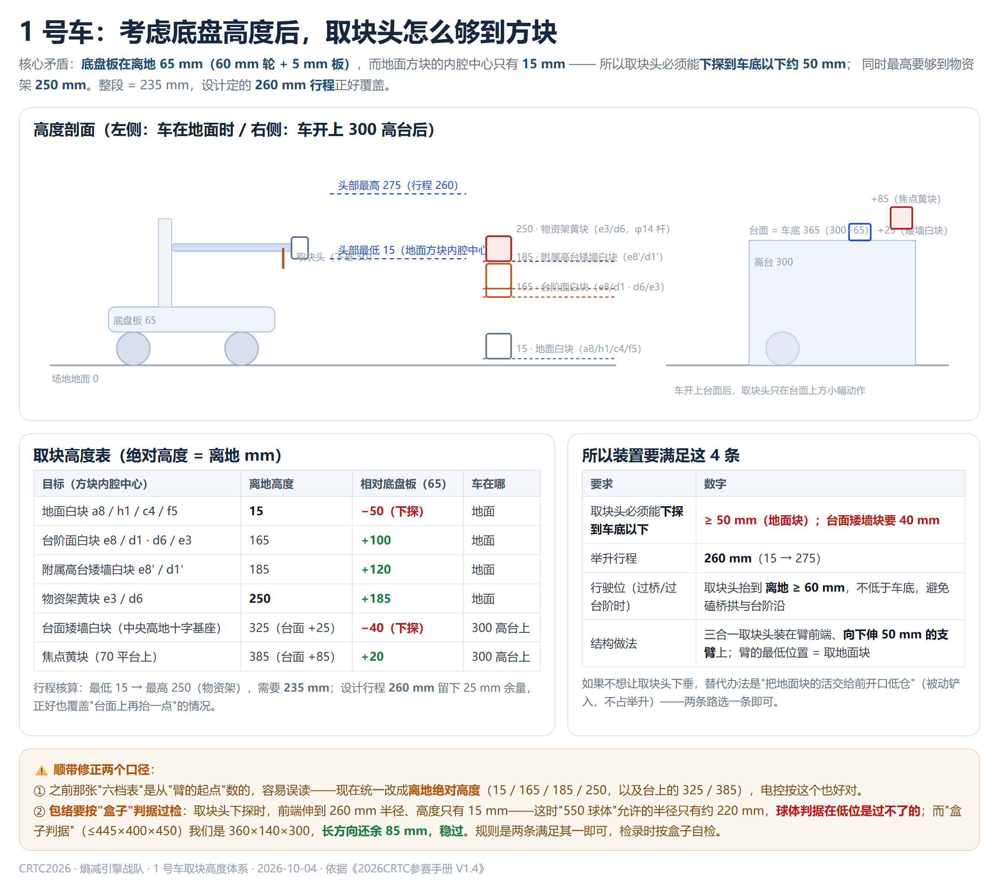

[打开图片：1号车取块高度体系](images/设计图/1号车取块高度体系.png)

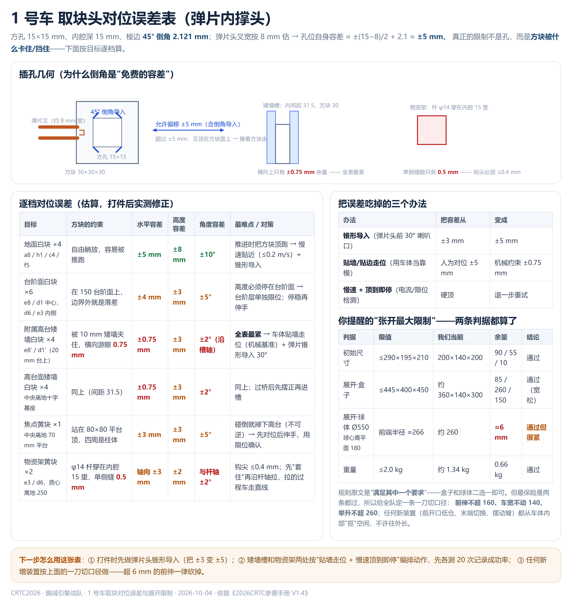

[打开图片：取块头对位误差表](images/设计图/取块头对位误差表.png)

**手柄按键分配：**

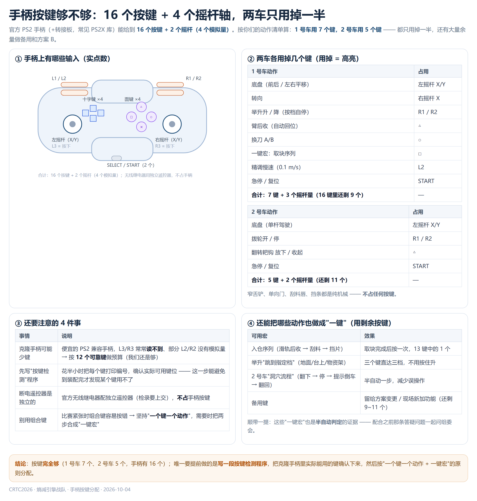

[打开图片：手柄按键分配](images/设计图/手柄按键分配.png)

### 2026-10-07 一号车升级定型：模块化立柱 + 快换多头

- 记录人：蔡昌恒
- 适用对象：1 号车
- 改动（改前 → 改后）：立柱改「上段通用、下段可换」的两形态（A 直段 / B 斜折，拔销换装 ≤5 分钟）；抓取头改「一个快换接口、多种头」（平行夹爪 / 弹片内撑＋倒刺 / 低位耙钩）。
- 为什么改：训练与冲分共用标定与程序；一个接口配多种头，主力夹爪保通用、被动头补断电安全与物资架轴向抽出。
- 影响与后续动作：两侧孔列与加强插孔同批定稿；2 号车确认回归 PS2 手动（见通用板块）。

### 2026-10-08 决定一号车改用 60mm 普通橡胶轮

- 记录人：李秉航
- 适用对象：1号车
- 改动（改前 → 改后）：剔除1号车使用麦轮进行原地旋转的可能
- 为什么改：一号车任务核心是“上坡 → 举升 → 夹块 → 回仓”，不需要横向平移；麦轮辊子摩擦小，爬 26.6° 坡（方案书里的坡比 0.5）容易打滑，橡胶轮抓地更好。差速代码也比麦轮逆解简单，调试快。 放弃麦轮的直接代价：失去侧移贴台能力，贴物资架/焦点时要“斜开+原地转正”，走位变慢。方案书里“加 150~250g 后配重下坡余量 ≥30°”的结论对橡胶轮只会更宽松，所以爬坡安全余量反而变大。 1号车走拱桥使用麦轮不方便
- 影响与后续动作：chassis.h需要改
- 后续：最终方案（2026-10-12）确认 1 号车仍采用已购 φ60 麦轮 ×4，本条按当日日报保留、仅作过程记录。

**当天照片：**

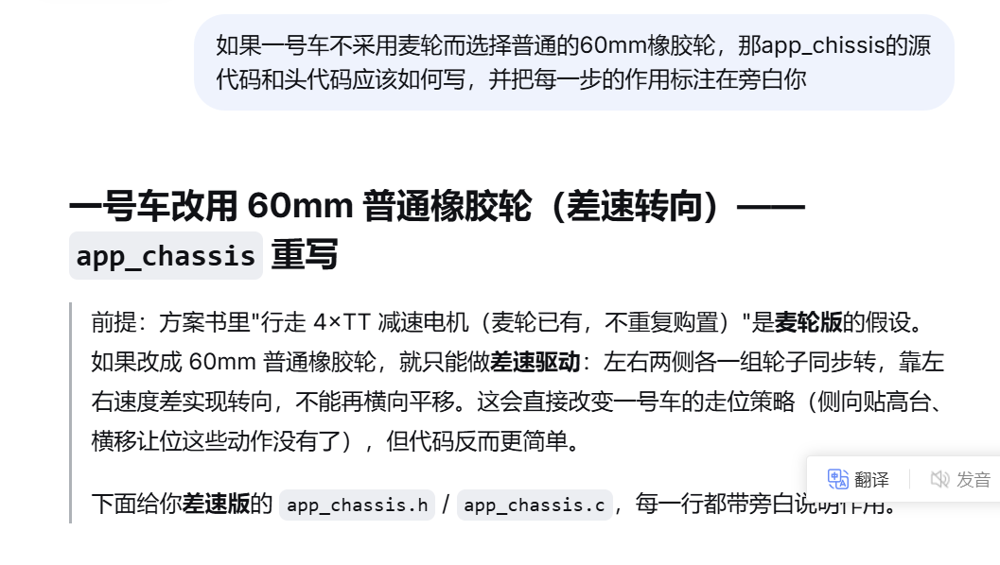

[打开图片：李秉航-1-e48bd297](images/日报配图/2026-10-08/李秉航-1-e48bd297.png)

### 2026-10-12 一号车大修：C 口立柱 + 抱柱滑座 + 快换统一背板 + 后部布局

- 记录人：蔡昌恒
- 适用对象：1 号车
- 改动（改前 → 改后）：底盘后缘 −100 → −108，整车 200 → **208 × 140 × 207**；立柱改 46×46×190 **前面全高 C 口**（内腔 40×40 走丝杆＋双光轴），抱柱滑座 48×48×46（LM6UU 中心距 **27**）；侧孔列板 184 → **130×40×4**；快换头统一为 **18×48×24 背板 + 10×16×6 公板**（2×M3@±16 + φ5.05 定位销）；电池仓 75×42×22 与电控托盘 68×44×16 后区叠放（M3 铜柱 28）。
- 为什么改：① 电控托盘/电池仓放不进旧布局 → 后区后移 48 深；② 滑座中心距 34 会穿柱壁、28 顶壁，27 唯一可行；③ 三头接口不统一 → 统一背板，换头约 10 秒。
- 影响与后续动作：行程 46→172（126 mm）；N20 后置高位 + 2GT-6 闭环带 112（皮带过立柱 16×11 槽）；图册/尺寸卡/14 步装配全量重出。

### 2026-10-13 一号车料仓改「堆块筒」＋杆件口径统一

- 记录人：蔡昌恒
- 适用对象：1 号车
- 改动（改前 → 改后）：T 形竖道料仓作废 → **堆块筒 53×80×64**（内腔 50×74，垂直垒 2 层，可选加高圈→3 层）；杆件改现货整根：T8 φ8×150、φ6 光轴 150×2、φ5×500 代切；铜套统一 **φ5×φ8×8（长 8）** 压 φ8.1 孔。
- 为什么改：立柱前仅约 54 mm 且手臂无偏航，平铺连 2 块都放不下 → 方块是刚体，用筒壁约束垂直垒高；初版 98 高过高，砍到 64（矮 1/3）。
- 影响与后续动作：3 块/趟（加高圈 4 块）；落格 KW11×2（z≈57/87）；走线槽 z8~56。
