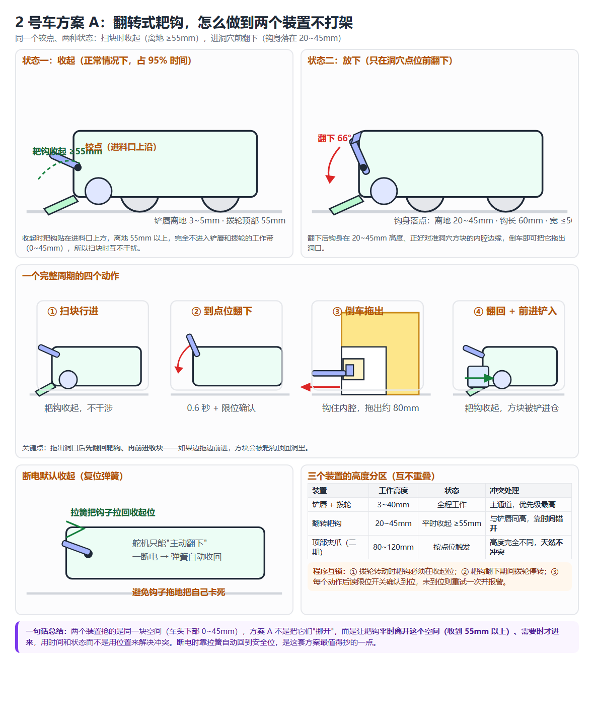
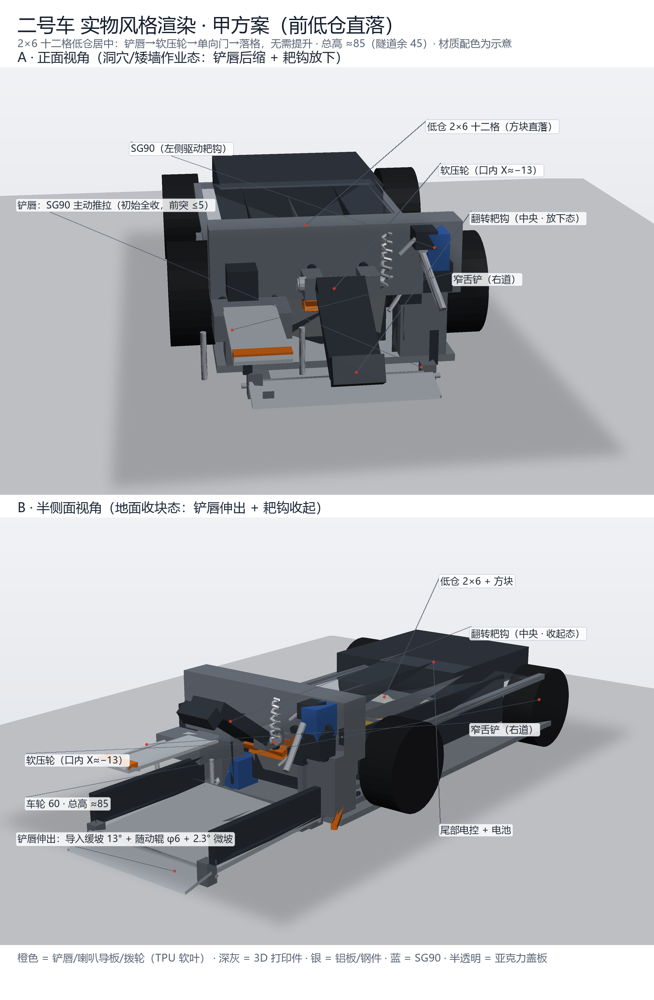
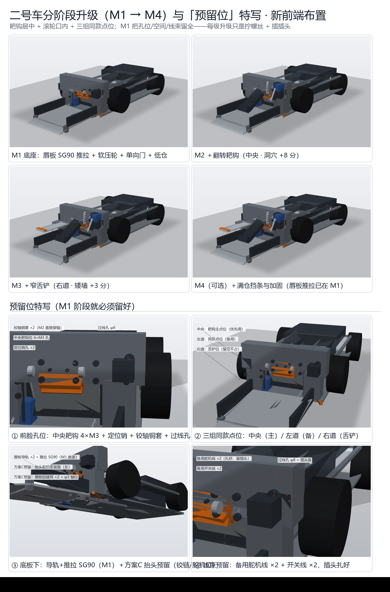
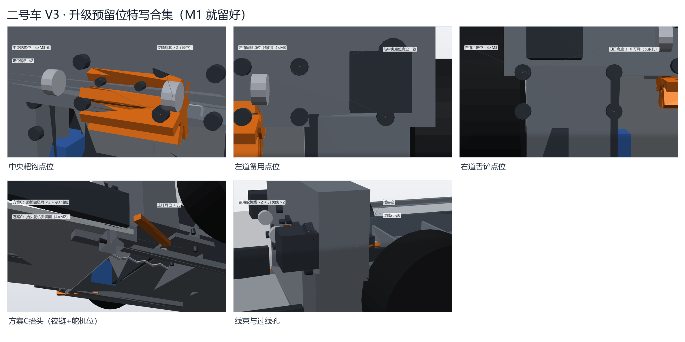
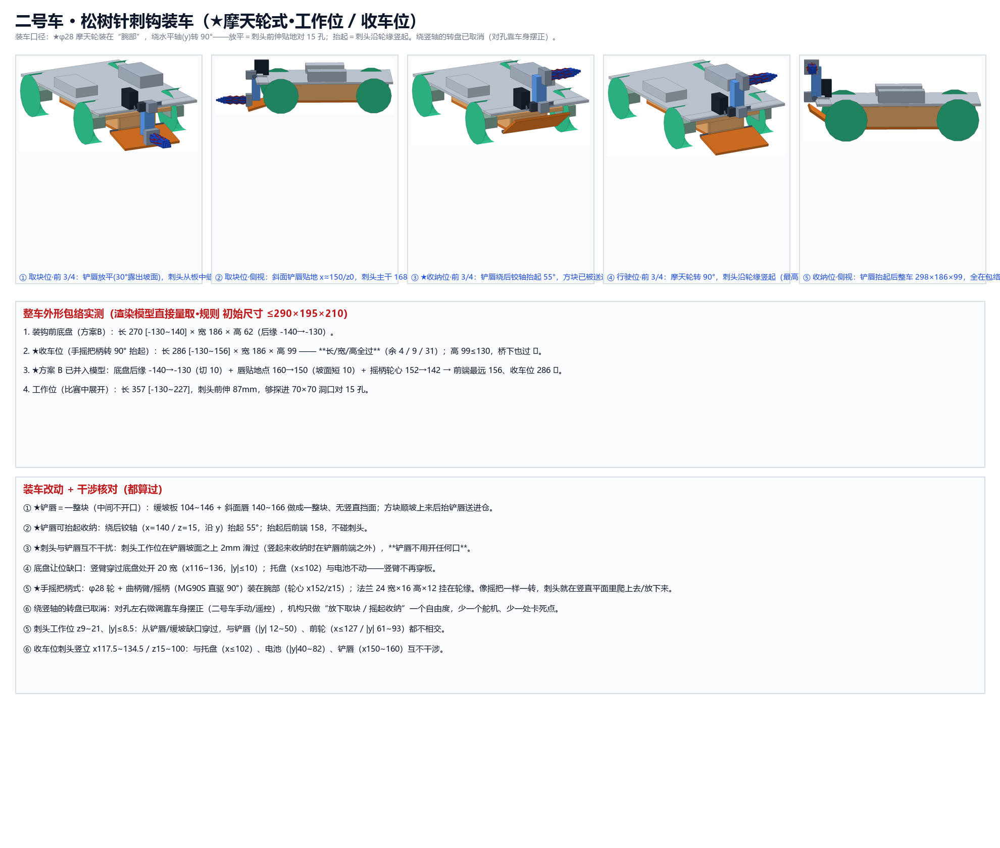
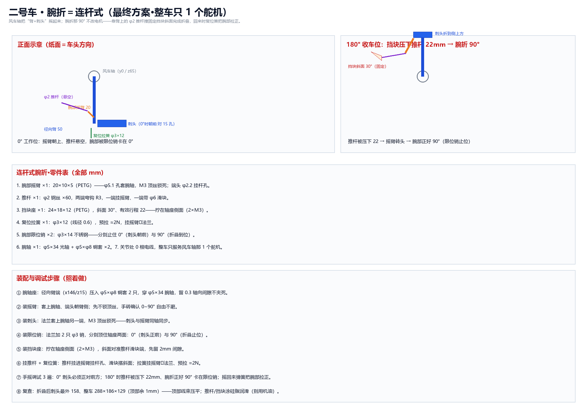
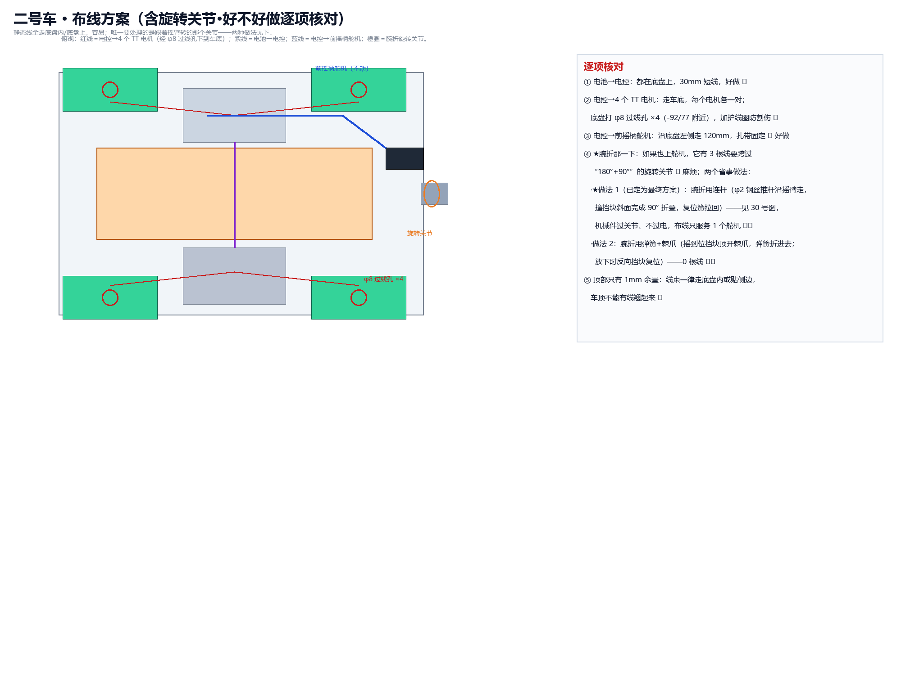
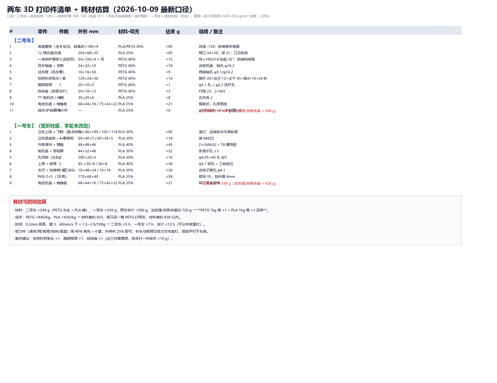

# 04.02 二号车设计思路

> 记录 2 号车的设计变化（改了什么、为什么改、影响什么），按日期从早到晚追加。来源：日报 + 大修记录；整机口径见 [1.1 外形展示](1.1-外形展示.md)。

## 2 号车

**2026-09-28 初始设计思路（立项）**

- 记录人：蔡昌恒
- 适用对象：2 号车
- 改动（改前 → 改后）：从零开始 → 定为"四轮差速收运车"，全自动无操作手，负责刷数量
- 为什么改：白块在全自动模式下按 2 分/颗计，专职收地面散块比让 1 号车兼顾更划算；且自动车不怕冲撞、判罚风险低
- 影响与后续动作：据此确定铲唇+拨轮+单向门、10 格料仓；遗留问题——整车 180 mm 高，钻不过 130 mm 的桥下空间

<!-- 追加位置 -->

**当天照片：**

[打开图片：蔡昌恒-1-bfba95ef](images/日报配图/2026-09-28/蔡昌恒-1-bfba95ef.png)

### 2026-10-05 二号车 V3 定稿：低仓直落 + 耙钩居中 + 铲板 SG90 推拉 + 导入缓坡与随动辊 + 方案 C 预留位

- 记录人：蔡昌恒
- 适用对象：2 号车
- 改动（改前 → 改后）：V2 是“铲板被动回缩 + 45° 短坡”；V3 改成“铲板舵机推拉（平时全收）+ 13° 缓坡 + φ6 随动辊”，另外把方案 C（铲唇抬头）的铰链位和舵机位先留出来。
- 为什么改：① 检录要求初始长度 ≤290，铲板必须能收进去；② 方块在路上容易顶歪、卡边；③ 先把升级接口留好，免得以后返工。
- 影响与后续动作：所有图和文档都切到 V3；下一步出《M1 打印清单》（要把 φ6 滚轮、轴、两侧支架加进去）；验证还是老三样：同一颗方块连收 20 次、纸板搭 70×70×50 的洞、e1/d8 坡上下 10 次。

**当天照片：**

[打开图片：蔡昌恒-1-f63f3c6b](images/日报配图/2026-10-05/蔡昌恒-1-f63f3c6b.png)

[打开图片：蔡昌恒-2-06a4d9b5](images/日报配图/2026-10-05/蔡昌恒-2-06a4d9b5.png)

[打开图片：蔡昌恒-3-53c8fd49](images/日报配图/2026-10-05/蔡昌恒-3-53c8fd49.png)

### 2026-10-09 取块头改"风车摇柄 + 连杆腕折"，铲唇改一整块斜面板，底盘后缘收 10mm

- 记录人：蔡昌恒
- 适用对象：2 号车
- 改动（改前 → 改后）：改前＝转盘绕竖轴旋转 + 竖直臂 + 刺头 90° 折叠 + 铲唇开 24 让位缝；改后＝绕车头纵轴的风车摇柄（MG90S 直驱 180°）+ 连杆腕折 90° + 一体斜铲唇（抬起 35°）。
- 为什么改：① 转盘侧摆会超长、又多一个卡死点；② 铲唇必须一整块、前面只露坡面；③ 关节走线越少越不容易出故障。
- 影响与后续动作：图册 24~31 已全部更新并同步三处；下一步 ① 打印针头/摇臂/挡块做连杆实测；② 重画 19~23 那 5 张旧方案文案；③ 验收三件事：收车位整车 288 复尺、刺头过 15 孔 20 次、收放 20 次不卡。 今天学到一条通用经验：能"机械过关节"的动作就别用电线过关节——连杆/凸轮穿过旋转关节，比在关节处留活动线更耐用；这次腕折 90° 就是这样省掉一个舵机和 3 根线。 图 1 风车式转动四帧：0°取块位 → 60°/120°摇起 → 180°收车位（绕车头纵轴转，正面看像风车） 图 2 装车两姿态：工作位 347×186×93 / 收车位 288×186×129（全方向合规，桥下也过） 图 3 腕折连杆式：φ2 推杆＋30°挡块＋复位簧＋限位销，旋转关节 0 根线 图 4 布线方案：静态线走底盘内+φ8 过线孔；腕折改连杆后关节无电线 图 5 打印件清单与耗材估算：二号车 ≈249g、一号车 ≈339g，合计留余量 ≈720g

**当天照片：**

[打开图片：蔡昌恒-1-abb6618e](images/日报配图/2026-10-09/蔡昌恒-1-abb6618e.png)

[打开图片：蔡昌恒-2-506fe10e](images/日报配图/2026-10-09/蔡昌恒-2-506fe10e.png)

[打开图片：蔡昌恒-3-57f47da5](images/日报配图/2026-10-09/蔡昌恒-3-57f47da5.png)

[打开图片：蔡昌恒-4-67224ce8](images/日报配图/2026-10-09/蔡昌恒-4-67224ce8.png)

[打开图片：蔡昌恒-5-b096f1bd](images/日报配图/2026-10-09/蔡昌恒-5-b096f1bd.png)

### 2026-10-12 二号车轮与托盘定型：φ70 轮 + 无隔板托盘 + 电控/电池高架

- 记录人：蔡昌恒
- 适用对象：2 号车
- 改动（改前 → 改后）：轮 60 → **φ70**；托盘去掉全部隔板（**204×68×35** 平盘）；新增 **电控/电池高架 160×70**（腿坐托盘壁顶 +24，电池靠尾、PCB 在前）；底盘 **270×180×4**。
- 为什么改：隔板会顶块 → 前端全开、持续进块；电控与电池没有位置 → 高架到托盘后段上方（方块顶上方留 4 mm）。
- 影响与后续动作：收车位 288×186×129；走线缺口、线夹孔、舵机线过线槽补全。

### 2026-10-13 二号车腕折机构修正：摇臂 R16 + 挡块座定形

- 记录人：蔡昌恒
- 适用对象：2 号车
- 改动（改前 → 改后）：腕部摇臂 20 → **24×10×5**（R16）；新增 **挡块座 24×18×12**（底平段 3.2 + 30° 斜面升 12，2×φ3.2 拧轴座侧面）；随动辊取消（φ3 辊轴不再采购）。
- 为什么改："推杆压 22 → 腕折 90°"按 R16 算（弦长 ≈22.6）；原 20 长放不下挂杆孔距轴 16。
- 影响与后续动作：顶丝孔 φ2.5 从侧面打通至轴孔（攻 M3）；复位拉簧 φ3×12；装配第 8~10 步验收。
