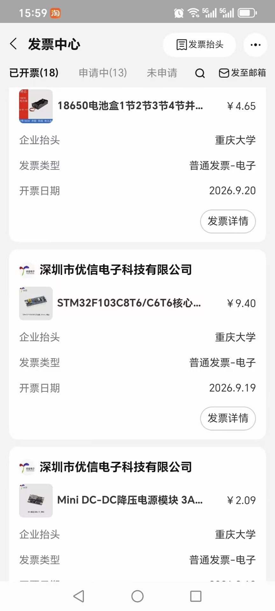
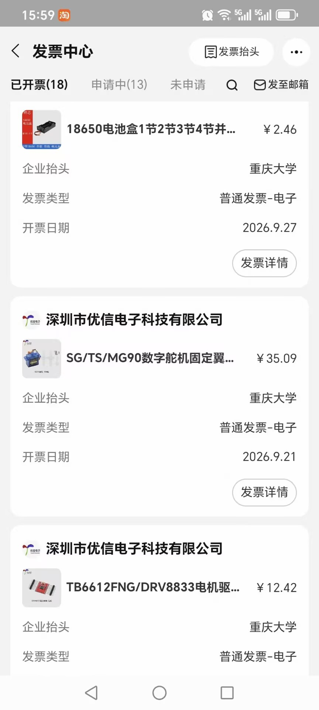
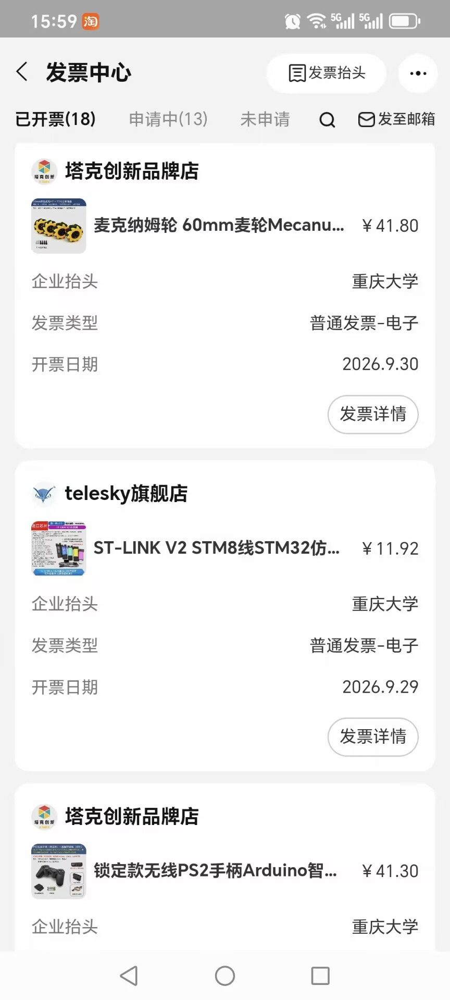
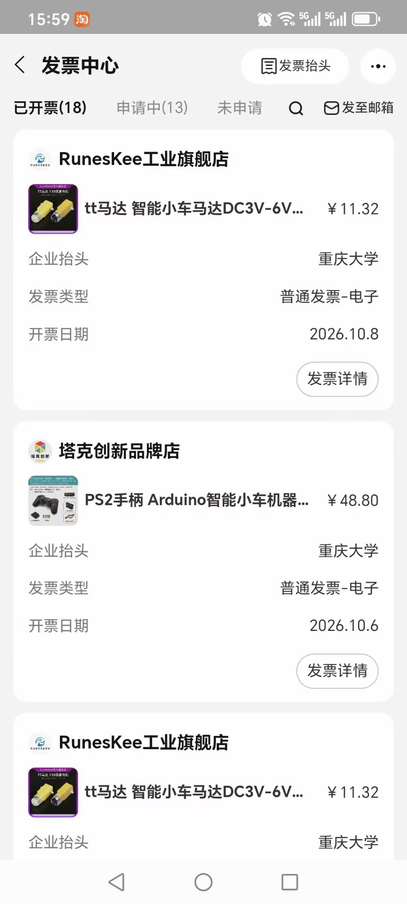
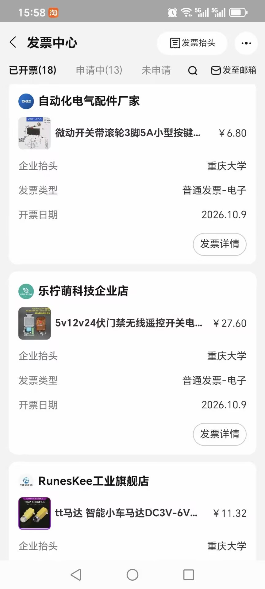

# 1.12 规划与现有采购单

- **考核要求**：核心部件选型 + 整机成本预算。
- **当前状态**：采购口径已定稿（V1.1），采购总表与采买包同步；票据截图待补。

## 我们的实现

采购按「官方物资表 + 3D 打印（实训队免费）」执行，V1.1 口径：

- **实际采购合计：¥536.31**（截至 2026-10-18，明细见「小车配件-实际采购表」）；其中「其他」类 **¥117.76** 为下单记录明细（见 `02-下单记录表`）。
- 报销上限 ¥400，超出约 ¥136.31 由队内自付（未过中期不予报销）。10-07 对账时已购 ¥388.48，之后按实际采购表更新。
- 计划口径（V1.1）：必买 ≈¥172.4；建议/强度升级 ≈¥72；待确认（无线继电器）¥25。
- 关键修订：二号车轮 60→φ70；KW11 ×8 恢复必买；新增开口挡圈；SG90×4 归位已购（备用）；T8 丝杆改 φ8×150 现货、φ6 光轴 150×2 现货；φ5 合并 1 根 500 代切；对穿销改 M4×80 螺丝（免切）；φ3 辊轴取消；铜套统一 φ5×φ8×8。
- 相关文件：`docs/05-物资与成本预算.md`；`docs/procurement/`（实际采购表 + 下单记录）；桌面「采买包-给采购同学-2026-10-08-定版V1.0」（07 总表 Excel、08 图版、10 待购清单等 9 份同口径）。

## 方案与取舍

- 官方物资表内的件优先（检录风险低），非标结构全部 3D 打印（免费、可迭代）。
- 采购口径统一后，避免重复下单与预算超限（报销上限 ¥400，超出自付）。

## 开发历程（精简）

- 2026-09-28：报名与仓库搭建。
- 2026-10-07：采购对账（已购 15 项逐项核对）。
- 2026-10-11：采购口径 5 处修订并同步 9 份文件。
- 2026-10-13：杆件代切 / 铜套长 8 / 取消 φ3 辊轴 → V1.1。

## 证据

- [x] 实际采购表：[小车配件-实际采购表.xlsx](procurement/小车配件-实际采购表.xlsx)（合计 ¥536.31）
- [x] 下单记录：[02-下单记录表.csv](procurement/02-下单记录表.csv)（「其他」¥117.76 的明细）
- [x] 发票截图（淘宝发票中心「已开票 18 张」，样例 5 张见下节）
- [ ] 07-完整采购总表截图（待提供）

## 发票截图（样例，抬头：重庆大学）

*发票 01：18650 电池盒（¥4.65）、STM32F103C8T6 核心板（¥9.40）、Mini DC-DC 降压模块（¥2.09）。*

*发票 02：18650 电池盒（¥2.46）、SG/TS/MG90 数字舵机（¥35.09）、DRV8833 电机驱动（¥12.42）。*

*发票 03：60mm 麦克纳姆轮（¥41.80）、ST-LINK V2（¥11.92）、PS2 无线手柄（¥41.30）。*

*发票 04：TT 马达（¥11.32）、PS2 手柄（¥48.80）、TT 马达（¥11.32）。*

*发票 05：微动开关（¥6.80）、无线遥控开关（¥27.60）、TT 马达（¥11.32）。*
