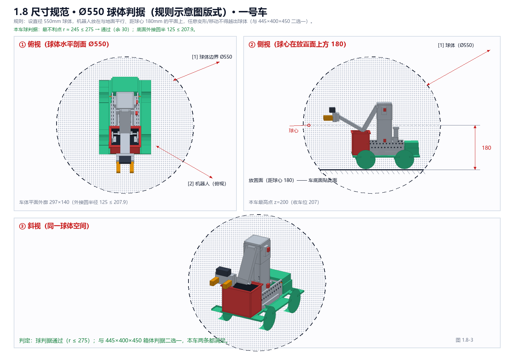
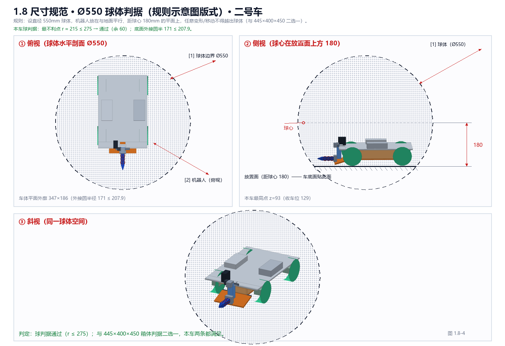
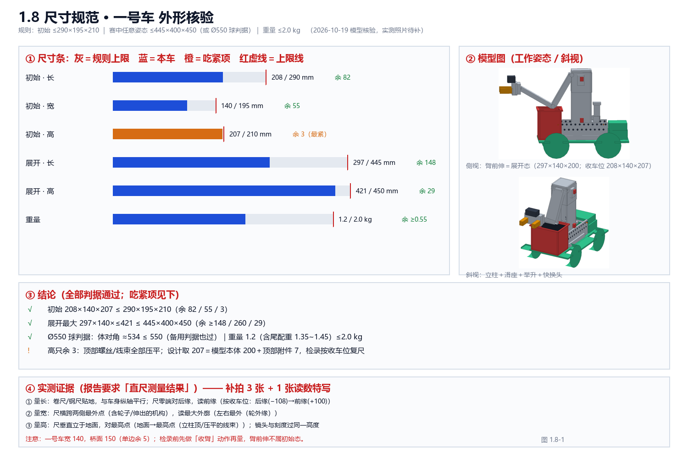
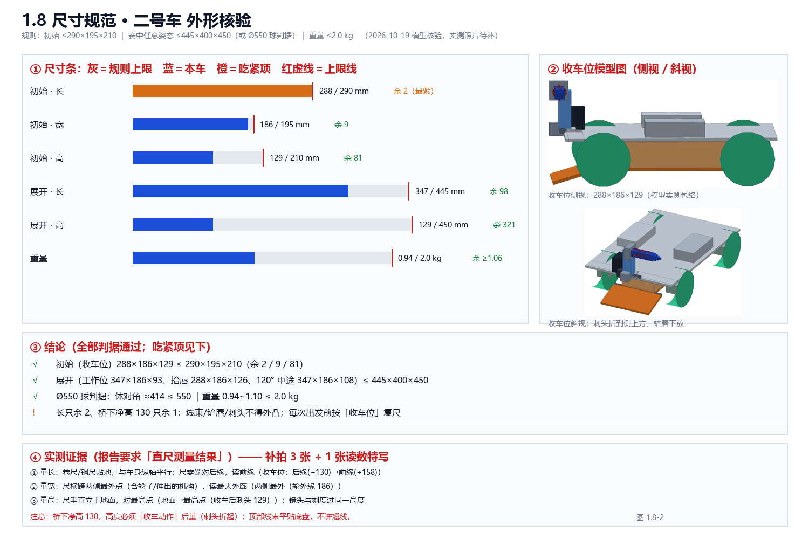

# 1.8 尺寸规范

- **考核要求**：机器人尺寸在规则限制范围之内（需展示直尺等测量工具的测量结果）。
- **当前状态**：设计尺寸已核对，实测待补（实物未组装）。

## 限值与设计值

- 规则限制：初始长宽高 ≤ 290 × 195 × 210 mm；展开 ≤ 445 × 400 × 450 mm 或直径 550 mm 球体判据；单台重量 ≤ 2.0 kg。
- **1 号车：208 × 140 × 207 mm**（长余 82 / 宽余 55 / 高余 3）；重量约 1.2 kg（含车尾配重约 1.35~1.45，≤2.0 ✓）。
- **2 号车：收车位 288 × 186 × 129 mm**（长余 2 / 宽余 9 / 桥下净高 130，余 1）；重量约 0.94~1.10 kg（≤2.0 ✓）。

## 方案与取舍

- 1 号车收窄到 140 mm：桥面仅 150 mm，宽度是过桥生命线；车底导向片把偏航限制在 ±3 mm。
- 2 号车压到 129 mm：桥下净高 130，压平后才有资格钻隧道；线束全部走底盘内/贴侧边，顶部不允许翘线。
- 检录前按「收车动作」摆位并复尺（1 号车收臂、2 号车收刺头）。

## 开发历程（精简）

- 2026-09-28：按限值确定设计值。
- 2026-10-09：2 号车收车位复尺 288×186×129。
- 2026-10-12：1 号车大修后 208×140×207（后区 −108）。

## 证据（待补）

- [ ] 直尺测量照片（三方向，文件名：待提供）
- [ ] 称重照片（文件名：待提供）
- [ ] 建模尺寸图（文件名：待提供）

