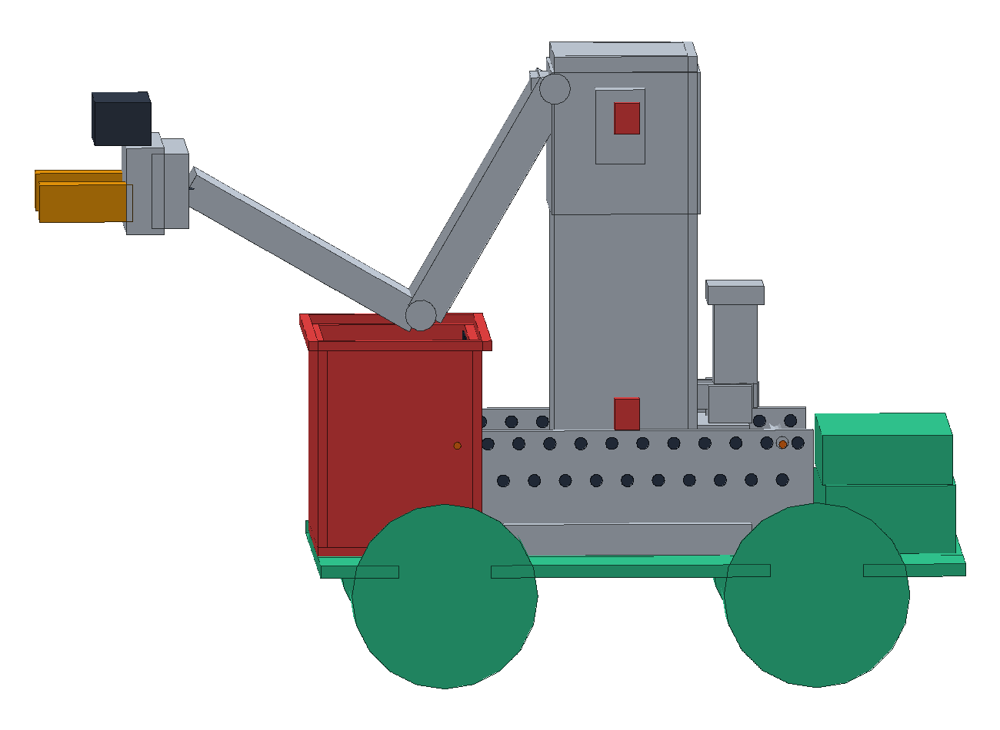
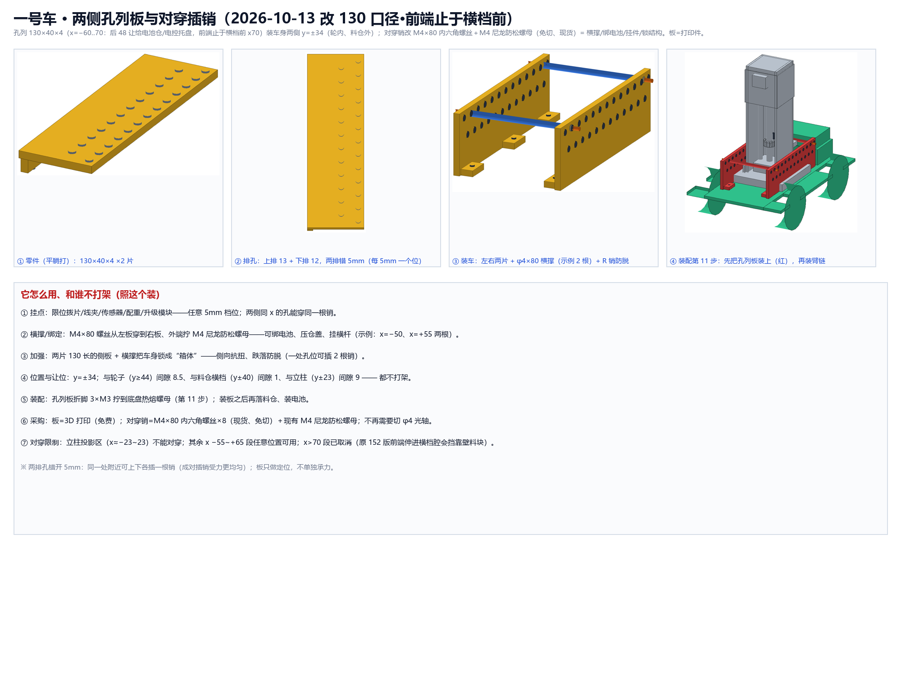
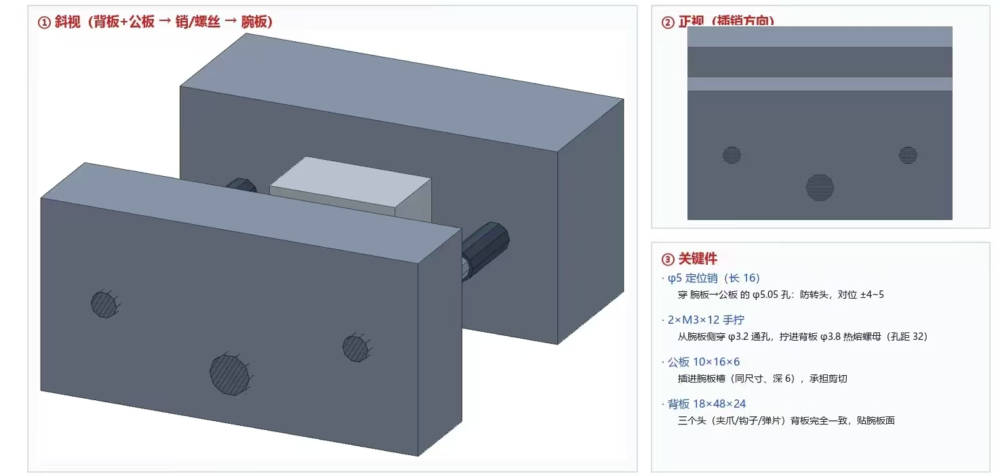
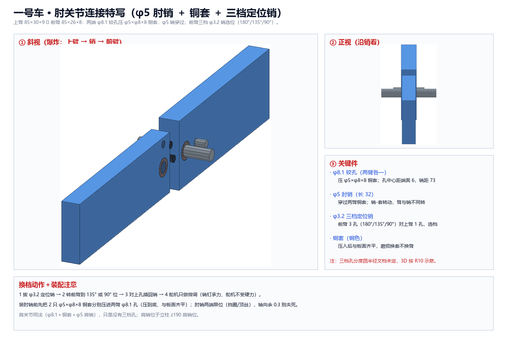

# 2.1 手动自由度：排孔 + 插销关节

- **关联基础功能**：1.1 外形展示 / 1.9 方块携带（1 号车）
- **一句话**：给 1 号车增加两个手动自由度——立柱两侧排孔与臂中段插销关节，用来补精度、防前倾、简化布线。
- **当前状态**：结构方案完成（见 1.1 结构图）；实物未组装，装配与演示待补。

## 方案与取舍

1. **立柱两侧排孔（侧孔列板）**：130×40×4 ×2，双排 φ4.05（上排 13 孔、下排 12 孔，两排错 5 mm），折脚 3 处（x=−50/0/+60），配 M4×80 对穿销 + 防松螺母。作用：容错与补齐设计精度、车身两侧挂点、横撑/绑定位。
2. **臂中段插销关节**：抓取臂中间加一个手动固定关节，用插销锁定角度。作用：避免手臂过长过重导致整车前倾，同时降低布线难度。
3. 曾考虑用结构调整实现重心后移，最终舍弃该结构（图片待补）。

## 难点与取舍

- 排孔位置与轮、料仓、立柱投影区多次冲突：最终定 y=±34、z40~80，前端止于 x70、后 48 让给电池区。
- 手动自由度换来的是稳定性与容错，同时不增加带电结构与舵机数量。

## 证据（待补）

- [ ] 排孔与插销关节实物/渲染图（待提供）
- [ ] 对穿销绑扎演示照片（待提供）

[打开图片：2.1-排孔与插销-01](images/过程图/2.1-排孔与插销-01.png)

[打开图片：2.1-排孔与插销-02](images/过程图/2.1-排孔与插销-02.png)

[打开图片：2.1-排孔与插销-03](images/过程图/2.1-排孔与插销-03.jpg)

[打开图片：2.1-排孔与插销-内嵌04](images/过程图/2.1-排孔与插销-内嵌04.png)
