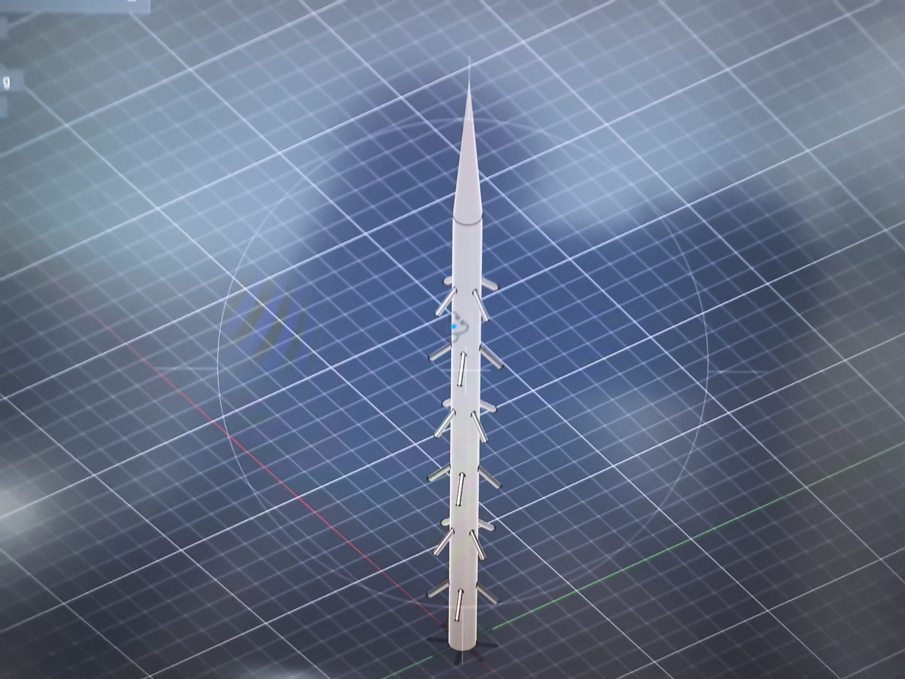
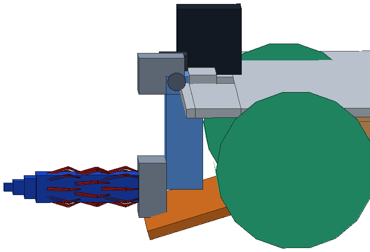

# 2.3 松树型倒刺（掏取）

- **关联基础功能**：1.9 方块携带（单一）/ 1.10（2 号车）
- **一句话**：2 号车用车头风车摇柄上的松树型倒刺，把洞穴里的方块「掏出来」，再由铲唇接收。
- **当前状态**：结构方案完成（松树针头渲染见证据）；实物未组装，掏取演示待补。

## 方案与取舍

- 结构：3 圈 × 8 根独立细针（φ1.6、最长 15、外径 17），可穿过方块 15 孔；摇柄绕车头纵轴 0°~180°（MG90S 直驱），腕部连杆折 90° 收纳（关节 0 根电线）。
- 流程：车头对正洞口 → 刺头前伸入孔、细针弹开咬住内壁 → 摇柄回拉把方块拖出 → 摇到收车位 → 铲唇接住。
- 把抓取简化为「插入—摇出—接收」三段动作，控制难度低；比夹爪少了电机与对位精度要求。

## 难点与解决

- 细针 3D 打印质量差 → 改「圆柱体 + 手工插细铁丝」的松针头。
- 刺头竖起来会插进坡板 → 铲唇改一整块斜面板，刺头从坡面上方通过。
- 收车位超长/超高 → 后缘收 10、摇柄轮缩到 φ26、轴心前移，最终收车位 288×186×129。

## 证据（待补）

- [ ] 掏洞穴方块演示视频（待提供）
- [x] 松树针头 Fusion 渲染图：[松树针头-Fusion模型.jpg](images/设计图/松树针头-Fusion模型.jpg)

[打开图片：松树针头 Fusion 模型](images/设计图/松树针头-Fusion模型.jpg)

[打开图片：2 号车取块位近景](images/设计图/机构近景-取块位（刺头+铲唇）.png)
